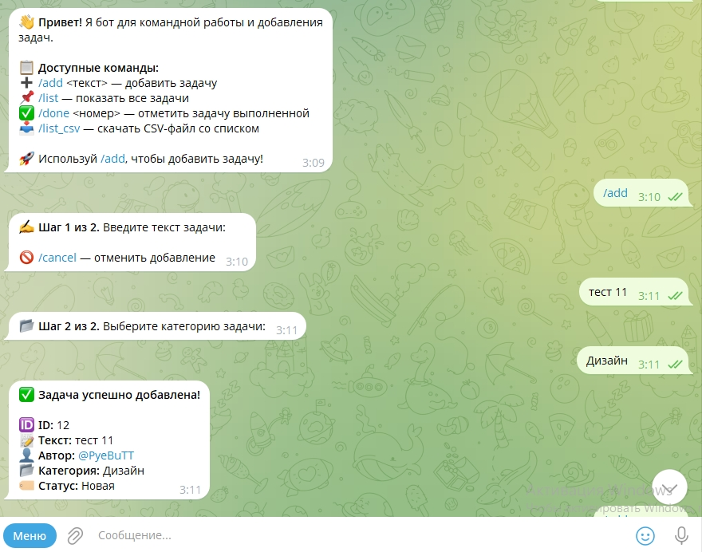
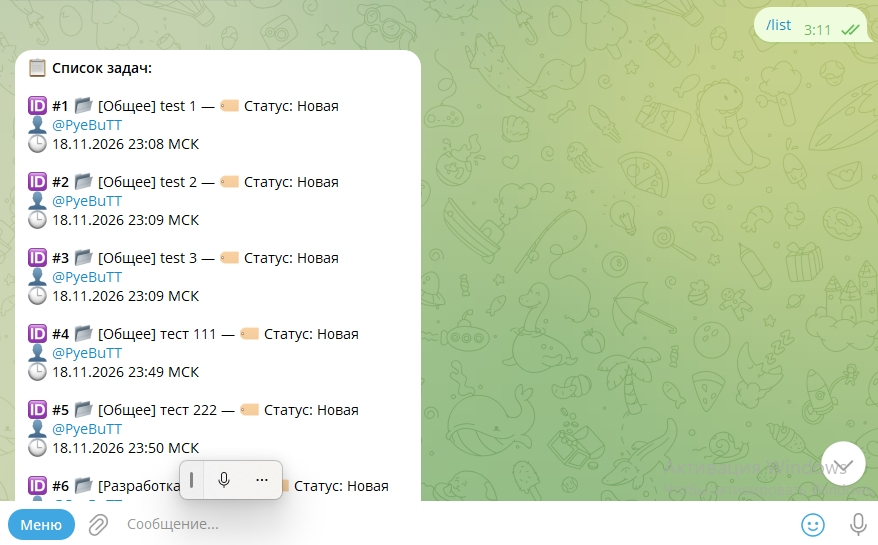
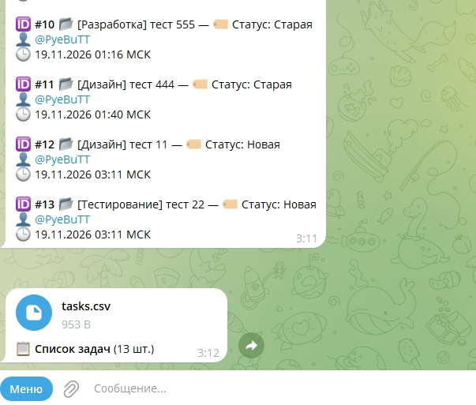
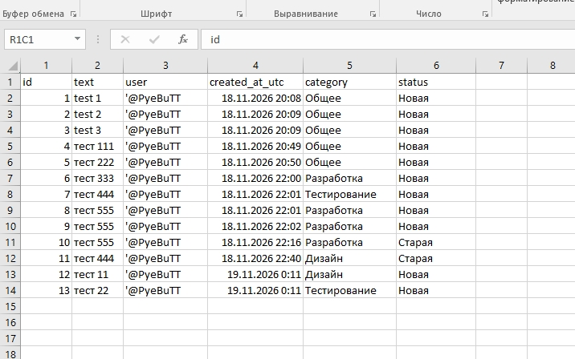

<div align="center">

# 📋 Team Tasks Telegram Bot (`team-tasks-tg-bot`)

## 📸 Скриншоты работы бота

| Приветствие и добавление задачи | Общий список задач (`/list`) |
| :---: | :---: |
|  |  |

| Выгрузка CSV в Telegram (`/list_csv`) | Открытие CSV в Excel |
| :---: | :---: |
|  |  |


**Асинхронный Telegram-бот для ведения общего командного списка задач**

[](https://python.org)
[](https://aiogram.dev)
[](https://sqlite.org)
[](#-тесты)
[](#-архитектура-и-структура-проекта)

[Возможности](#-возможности) • [Архитектура](#-архитектура-и-структура-проекта) • [Установка и запуск](#-установка-и-запуск) • [Команды](#-команды-бота) • [Резервное копирование](#-резервное-копирование-базы-данных) • [Тесты](#-тесты)

</div>

---

## ✨ Возможности

- **Общий список задач для команды** — пошаговое добавление через FSM (`/add`) с выбором категории («Разработка», «Дизайн», «Тестирование», «Общее»).
- **Атомарный контроль дублей** — автоматическое определение повторных задач в транзакции SQLite (`BEGIN IMMEDIATE`) без учёта регистра и лишних пробелов. Новая уникальная задача получает статус **«Новая»**, повтор — **«Старая»** (исходная запись при этом не меняется).
- **Строгий контракт статусов** — доменная валидация состояний (`Новая`, `Старая`, `Выполнена`) и быстрое закрытие задач командой `/done <номер>`.
- **Безопасный экспорт в CSV** — выгрузка таблицы (`/list_csv`) в кодировке UTF-8 с BOM для корректного открытия в Excel и встроенной защитой от формульных инъекций (`=`, `+`, `-`, `@`).
- **Устойчивость к сбоям сети и БД** — автоматическое ожидание доступности Telegram API (с повторами каждые 10 секунд), опциональная поддержка HTTP-прокси и перехват ошибок SQLite без падения бота.

---

## 🏗 Архитектура и структура проекта

Проект построен по принципам слоистой архитектуры с однонаправленными зависимостями: **`ui -> core <- driver`**. Доменное ядро (`core`) полностью изолировано от фреймворка Telegram и драйвера базы данных.

```text
VPb06/
├── main.py                  # Точка входа, сборка зависимостей и запуск polling
├── config.py                # Загрузка настроек из переменных окружения / .env
├── requirements.txt         # Зависимости проекта
├── .env.example             # Шаблон конфигурации
├── core/                    # Доменное ядро (не зависит от aiogram и SQLite)
│   ├── models.py            # Сущность Task, валидация статусов и нормализация текста
│   ├── errors.py            # Доменные и инфраструктурные исключения
│   ├── ports.py             # Протоколы TaskRepository и TaskExporter
│   └── services.py          # Бизнес-логика (TaskService)
├── driver/                  # Адаптеры хранения и экспорта
│   ├── sqlite_task_repository.py  # Асинхронный репозиторий SQLite (aiosqlite)
│   └── csv_exporter.py            # Генератор CSV в памяти с защитой от инъекций
├── ui/                      # Пользовательский интерфейс
│   └── telegram/
│       ├── handlers.py      # Обработчики команд и FSM-сценариев
│       ├── states.py        # Состояния диалога добавления задачи
│       ├── keyboards.py     # Клавиатуры выбора категорий и кнопка Start
│       └── formatters.py    # HTML-форматирование списков и разбивка длинных сообщений
└── tests/                   # Модульные и интеграционные тесты (39 тестов)
```

---

## 🚀 Установка и запуск

### 1. В Windows (PowerShell)

Перейдите в каталог проекта `VPb06`, активируйте виртуальное окружение и установите зависимости:

```powershell
.\venv\Scripts\Activate.ps1
python -m pip install -r requirements.txt
Copy-Item .env.example .env
```

Откройте созданный файл `.env` и укажите токен вашего бота, полученный у `@BotFather`:

```dotenv
TELEGRAM_BOT_TOKEN=your_bot_token_here
# Опционально: путь к файлу БД (по умолчанию tasks.db в папке проекта)
# TASKS_DB_PATH=tasks.db
# Опционально: HTTP-прокси, если api.telegram.org недоступен напрямую
# TELEGRAM_PROXY_URL=http://127.0.0.1:8080
```

Запустите бота:

```powershell
python main.py
```

Остановить работу можно сочетанием клавиш `Ctrl+C`.

> **Важно:** запускайте только **один** экземпляр бота. Два одновременно работающих процесса с одним токеном вызывают конфликт (`Conflict: terminated by other getUpdates`), из-за чего команды начинают отвечать через раз.

### 2. В WSL / Linux

Если используется готовое Windows-окружение `venv/`, его можно запускать напрямую из WSL:

```bash
PYTHONIOENCODING=utf-8 ./venv/Scripts/python.exe -B -m unittest discover -s tests -v
PYTHONIOENCODING=utf-8 ./venv/Scripts/python.exe main.py
```

Либо создайте отдельное Linux-окружение `.venv-linux` и установите зависимости из `requirements.txt`.

---

## 🤖 Команды бота

| Команда | Описание |
| :--- | :--- |
| `/start` | Вывести приветствие и краткую справку (дублируется постоянной кнопкой **Start**). |
| `/add` | Пошаговое добавление задачи: ввод текста → выбор категории (`Разработка`, `Дизайн`, `Тестирование`, `Общее`). |
| `/add <текст>` | Быстрый старт добавления: текст передаётся сразу, остаётся выбрать категорию. |
| `/cancel` | Отменить добавление задачи на любом шаге диалога. |
| `/list` | Показать общий список задач с категориями, статусами и временем добавления (UTC+3, Москва). |
| `/done <номер>` | Отметить задачу с указанным номером как **«Выполнена»**. |
| `/list_csv` | Выгрузить все задачи в CSV-файл (`id;text;user;created_at_utc;category;status`). |

*Если у пользователя Telegram не задан `username`, в качестве автора сохраняется его числовой Telegram ID.*

---

## 💾 Резервное копирование базы данных

- **CSV не заменяет бэкап:** выгрузка `/list_csv` предназначена для отчётности — она округляет время до минут, экранирует формульные символы и не имеет обратного импорта.
- **Как делать резервную копию:** используйте штатный механизм SQLite, который безопасно создаёт консистентный снимок даже при работающем боте. Не копируйте работающий файл `tasks.db` обычным копированием средствами ОС во время записи.

```bash
sqlite3 tasks.db ".backup 'tasks_backup.db'"
```

- **Смена пути к БД:** при изменении переменной `TASKS_DB_PATH` в `.env` бот автоматически создаст новую пустую базу данных по новому пути, если файла там ещё нет.

---

## 🧪 Тесты

Проект покрыт **39** модульными и интеграционными тестами (проверка доменной логики, миграции со старой схемы SQLite, конкурентной вставки дублей, экранирования CSV-формул и обработки ошибок хранилища в хендлерах).

Запуск всех тестов из папки `VPb06`:

```powershell
python -B -m unittest discover -s tests -v
```
